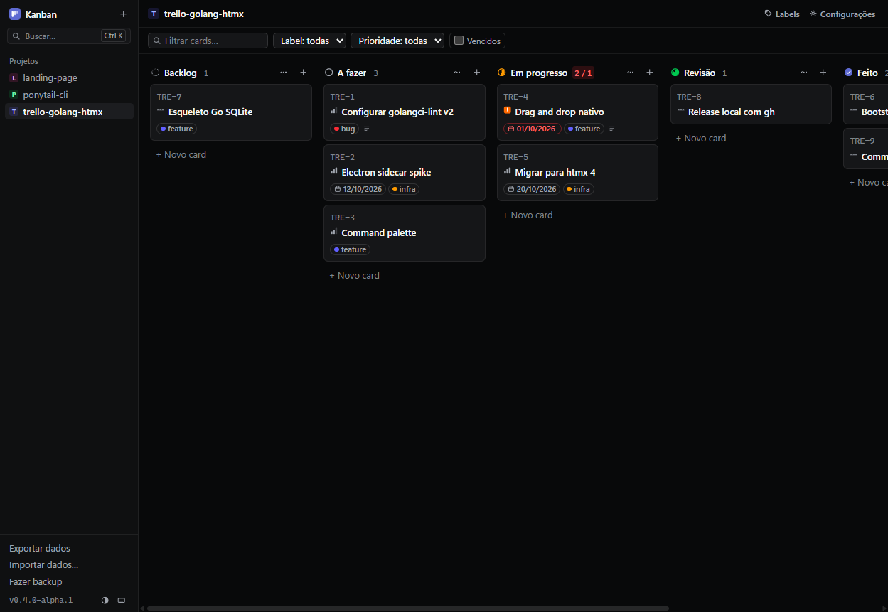
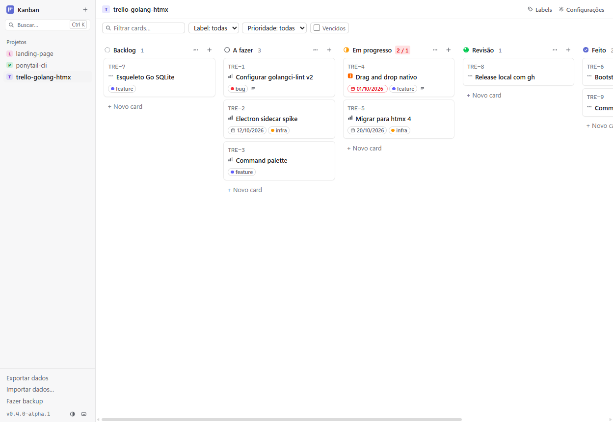

<div align="center">

<h1><strong><a href="https://github.com/AlexGalhardo/vukem-kanban" style="text-decoration: none" target="_blank">vukem-kanban</a></strong></h1>

[](https://github.com/AlexGalhardo/vukem-kanban/actions/workflows/ci.yml)
[](LICENSE.md)
[](go.mod)
<a href="https://github.com/AlexGalhardo/vukem-kanban/releases"></a>

<h3><strong>Open Source Single-User Kanban for Software Projects: Web and Desktop</strong></h3>

</div>

## Introduction

vukem-kanban is a personal, open source kanban in the style of Linear for managing software projects. It opens straight on the board, works offline and runs as a web app (Windows, Linux and macOS binaries) or as a Windows desktop app. There are no accounts: it is meant for one person on one machine.

The application is written in Go on the [Vukem framework](https://vukem.dev), with SQLite (`modernc.org/sqlite`, no CGO), htmx 4 and Tailwind CSS 4. The desktop build runs the Go binary as an Electron sidecar on a random loopback port.



| Card dialog | Command palette (light theme) |
| --- | --- |
|  |  |

## Summary

- [Introduction](#introduction)
- [Features](#features)
- [Quick start](#quick-start)
- [Documentation](#documentation)
- [Stability](#stability)
- [Contributing](#contributing)
- [Code of conduct](#code-of-conduct)
- [Security vulnerabilities](#security-vulnerabilities)
- [License](#license)

## Features

- Projects (boards) with default columns: Backlog, A fazer, Em progresso, Revisão, Feito (the interface is in Brazilian Portuguese).
- Cards with Linear-style IDs (`TRE-12`), priority, due date, Markdown description and labels.
- Drag and drop between and within columns, with a "Status" control as the keyboard alternative.
- Configurable columns: rename, reorder, WIP limit, delete while moving the cards.
- Search and filters by label, priority and overdue, reflected in the URL.
- Command palette (`Ctrl+K`) and shortcuts: `c` new card, `n` new project, `/` search, `g j`/`g k` switch project, `t` theme, `?` help.
- Light and dark themes, archive and restore projects, JSON export and import, and database backup.

## Quick start

```sh
git clone https://github.com/AlexGalhardo/vukem-kanban.git
cd vukem-kanban
bun install --frozen-lockfile
bun run dev          # Tailwind in watch mode + server on http://127.0.0.1:8080
```

Single binary (web):

```sh
bun run build
./bin/kanban --addr 127.0.0.1:8080 --db kanban.db
```

The binary is a Vukem app: `HOST`, `PORT`, `DATABASE_URL` and `LOG_LEVEL` also configure the server, and `./bin/kanban route:list`, `about` and `migrate:status` work as in any Vukem app.

Docker image (web, SQLite in the `/data` volume):

```sh
docker compose up -d --wait          # http://127.0.0.1:8080
curl -fsS http://127.0.0.1:8080/healthz
docker compose down -v               # -v deletes the volume with the database
```

Each `vX.Y.Z` tag publishes `ghcr.io/alexgalhardo/vukem-kanban` and `alexgalhardo/vukem-kanban` (Docker Hub) as `X.Y.Z`, `X.Y` and `latest` (stable tags only), after a smoke test (`--version`, `/healthz`, `/`), signed with cosign and with a provenance attestation.

Desktop:

```sh
bun run desktop      # development mode
bun run dist         # NSIS installer + portable build in dist/desktop/
```

Ready-made downloads (Windows, Linux and macOS binaries and the Windows installer) are on the [releases](https://github.com/AlexGalhardo/vukem-kanban/releases) page.

Checks:

```sh
bun run lint         # golangci-lint (gofumpt + goimports) + tsc
bun run test         # go test -race ./...
bun run smoke        # real binary: healthz, pages, static files, headers
bun run e2e          # Playwright, web
bun run e2e:desktop  # Playwright + Electron
```

## Documentation

- [PLAN.md](PLAN.md): phases and checklists.
- [docs/adr/](docs/adr/README.md): architecture decisions (ADRs).
- [docs/architecture.md](docs/architecture.md), [docs/tooling.md](docs/tooling.md), [docs/workflow.md](docs/workflow.md) and [docs/testing.md](docs/testing.md).
- [AGENTS.md](AGENTS.md): guide for AI agents.

## Stability

vukem-kanban follows [Semantic Versioning](https://semver.org) and tags releases as `vX.Y.Z` on `main`. Changes are listed in [CHANGELOG.md](CHANGELOG.md), which follows [Keep a Changelog](https://keepachangelog.com/en/1.1.0/). Release notes are the matching CHANGELOG section.

## Contributing

Thank you for considering a contribution.

- Read the design documents in `docs/` (decisions in `docs/adr/`) before changing behavior.
- Write the test first. Run the specific test, lint and typecheck that cover your change.
- Update `CHANGELOG.md` (under `[Unreleased]`) and the documentation in the same change when behavior, commands or conventions change.

The full guide (setup, checks, commit style) is in [CONTRIBUTING.md](CONTRIBUTING.md).

### Pull requests

1. Create a branch from `main`.
2. Make one logical change per commit.
3. Open a pull request against `main`; its title is a Conventional Commit.

`main` accepts changes only through a pull request with green required checks and linear history.

### Commits

Use [Conventional Commits](https://www.conventionalcommits.org/en/v1.0.0/) in English: `type(scope): description`.

- Types: `feat`, `fix`, `perf`, `refactor`, `docs`, `test`, `build`, `ci`, `chore`, `style`, `revert`.
- Scopes: `board`, `store`, `cmd`, `desktop`, `docker`, `ci`, `deps`, `docs`.

## Code of conduct

To keep the community welcoming to everyone, please review and follow the [Code of Conduct](CODE_OF_CONDUCT.md).

## Security vulnerabilities

If you discover a security vulnerability, please follow the [security policy](SECURITY.md) instead of opening a public issue.

## License

vukem-kanban is open source software released under the [MIT license](LICENSE.md).
