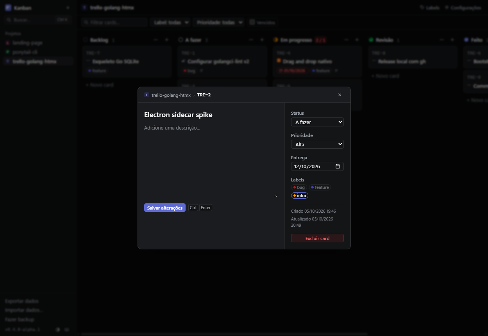

# Kanban — Go + htmx 4 + SQLite + Electron

Kanban single-user no estilo Linear para gerenciar o desenvolvimento de projetos de software. Abre direto no quadro, funciona offline e roda como app web ou desktop (Windows).

- **Backend:** Go 1.27 sobre o framework [vukem](https://github.com/AlexGalhardo/vukem) (`net/http`, `html/template`, `embed`) com SQLite (`modernc.org/sqlite`, sem CGO).
- **Frontend:** htmx 4.0.0 (vendorizado), Tailwind CSS v4, ~400 linhas de JS para drag-and-drop, atalhos e command palette.
- **Desktop:** Electron sobe o binário Go como sidecar em porta aleatória.


| Diálogo do card | Command palette (tema claro) |
| --- | --- |
|  |  |

## Funcionalidades

- Projetos (boards) com colunas padrão: Backlog, A fazer, Em progresso, Revisão, Feito.
- Cards com ID estilo Linear (`TRE-12`), prioridade, data de entrega, descrição e labels.
- Drag-and-drop entre e dentro de colunas; "Status" no card como alternativa por teclado.
- Colunas configuráveis: renomear, reordenar, limite WIP, excluir movendo os cards.
- Busca e filtros por label, prioridade e vencidos, refletidos na URL.
- Command palette (`Ctrl+K`) e atalhos: `c` novo card, `n` novo projeto, `/` buscar, `g j`/`g k` trocar projeto, `t` tema, `?` ajuda.
- Tema claro/escuro, arquivar/restaurar projetos, exportar/importar JSON e backup do banco.

## Rodando

Pré-requisitos: Go 1.27+, Bun 1.4+, `golangci-lint` 2.x.

```bash
bun install
bun run dev          # Tailwind em watch + servidor em http://127.0.0.1:8080
```

Binário único (web):

```bash
bun run build
./bin/kanban --addr 127.0.0.1:8080 --db kanban.db
```

O binário é um app vukem: `HOST`, `PORT`, `DATABASE_URL` e `LOG_LEVEL` também configuram o servidor, e `./bin/kanban route:list`, `about` e `migrate:status` funcionam como em qualquer app vukem.

Imagem Docker (web, SQLite no volume `/data`):

```bash
docker compose up -d --wait          # http://127.0.0.1:8080
curl -fsS http://127.0.0.1:8080/healthz
docker compose down -v               # -v apaga o volume com o banco
```

A cada tag `vX.Y.Z` o workflow `release.yml` publica `ghcr.io/alexgalhardo/vukem-kanban` e `alexgalhardo/vukem-kanban` (Docker Hub) com as tags `X.Y.Z`, `X.Y` e `latest` (só em versão estável), depois de um smoke (`--version`, `/healthz`, `/`), assinada com cosign e com attestation de proveniência.

Desktop:

```bash
bun run desktop      # modo dev
bun run dist         # instalador NSIS + portable em dist/desktop/
```

Downloads prontos (binários para Windows/Linux/macOS e instalador Windows) ficam nas [releases](https://github.com/AlexGalhardo/vukem-kanban/releases).

## Qualidade

```bash
bun run lint         # golangci-lint (gofumpt + goimports) + tsc
bun run test         # go test -race ./...
bun run smoke        # binário real: healthz, páginas, estáticos, headers
bun run e2e          # Playwright web
bun run e2e:desktop  # Playwright + Electron
```

## Documentação

- [PLAN.md](PLAN.md) — plano por fases com checklists.
- [docs/adr/](docs/adr/README.md) — decisões de arquitetura (ADRs).
- [docs/architecture.md](docs/architecture.md), [docs/tooling.md](docs/tooling.md), [docs/workflow.md](docs/workflow.md), [docs/testing.md](docs/testing.md).
- [CHANGELOG.md](CHANGELOG.md) — Keep a Changelog + SemVer; releases locais via `bun run release <versão>`.

## Licença

MIT.
